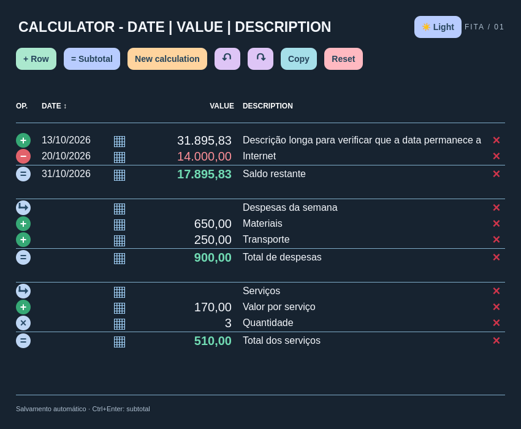

# Fita

Calculadora de fita para Linux e Omarchy Quattro, inspirada na organização de calculadoras de papel: **operação · data · valor · descrição · ações**. Botões e colunas em inglês, números alinhados à direita e separadores brasileiros.



## Experimentar

Requer Quickshell e os módulos Qt 6 Quick, Controls, Layouts e LocalStorage (disponíveis no Omarchy Quattro).

```sh
quickshell -p .
```

Em outro computador, use o caminho onde clonou este projeto.

## Usar

O botão Light/Dark alterna a aparência e salva a preferência. As colunas mantêm o alinhamento mesmo com descrições longas.

- Clique no botão circular para escolher a operação na primeira coluna, a data na segunda, o número na terceira e uma descrição livre na quarta.
- Use vírgula decimal: `1.234,56` ou `1234,56`. Ponto sempre indica milhar.
- `+ Row` acrescenta um valor ao final; Enter no valor ou na descrição insere uma linha logo abaixo e foca o novo valor.
- `= Subtotal` insere o resultado naquele ponto, sem reiniciar a conta. Atalho: Ctrl+Enter.
- `New calculation` separa um bloco e reinicia seu acumulador em zero.
- As operações são executadas de cima para baixo, sem precedência algébrica.
- Editar ou excluir linhas recalcula os resultados seguintes. Ctrl+Z desfaz; Ctrl+Shift+Z refaz.
- A coluna DATE aceita `DD/MM/AAAA` ou oito dígitos (formatados ao sair do campo). O botão de calendário permite selecionar dias, navegar entre meses, escolher hoje ou limpar. Datas inválidas aparecem em vermelho. Datas são salvas, copiadas e participam de desfazer/refazer.
- Clique em DATE para alternar entre ordem crescente e decrescente. Linhas sem data (ou com data inválida) ficam primeiro; datas iguais mantêm a ordem relativa. Cada trecho entre subtotais e novos cálculos é ordenado separadamente. A ordenação reorganiza as operações e recalcula os resultados; pode ser desfeita com Ctrl+Z.
- `Copy` envia a fita inteira para a área de transferência como texto tabulado.
- A fita e seu título são salvos automaticamente em SQLite usando Qt LocalStorage, na pasta de dados do Quickshell. Ctrl+S força o salvamento. O histórico de desfazer dura apenas a sessão.

A versão 0.1 mantém uma fita. Suporta até seis casas decimais, preservadas no cálculo e na exibição, e valores absolutos até 9.007.199.254,740991. Multiplicação e divisão arredondam para seis casas, com empates afastando de zero. Erros bloqueiam os resultados seguintes do mesmo bloco. Não executa expressões digitadas como código e não usa rede nem processos externos.

## Plugin do Omarchy

O manifesto na raiz declara `silfayner.fita` como painel. Valide com:

```sh
omarchy plugin validate /caminho/omarchy-fita
```

Instale usando a URL do repositório:

```sh
omarchy plugin add https://github.com/siflaynerdias/omarchy-fita.git --enable
omarchy-shell shell summon silfayner.fita '{}'
```

Para remover: `omarchy plugin remove silfayner.fita`. A remoção do plugin preserva os dados SQLite; não há hooks de instalação ou remoção.

## Testar

```sh
node tests/engine.test.cjs
node tests/date-sort.test.cjs
```

`test-smoke.qml` exercita recálculo e desfazer/refazer no QML, depois gera `/tmp/fita-preview.png`. Execute com um `XDG_DATA_HOME` temporário para não alterar a fita real.

## Publicação

Veja [PUBLISH.md](PUBLISH.md). A listagem depende de repositório público e aprovação dos mantenedores da loja.

Licença MIT.
